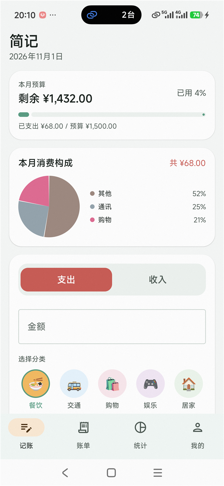
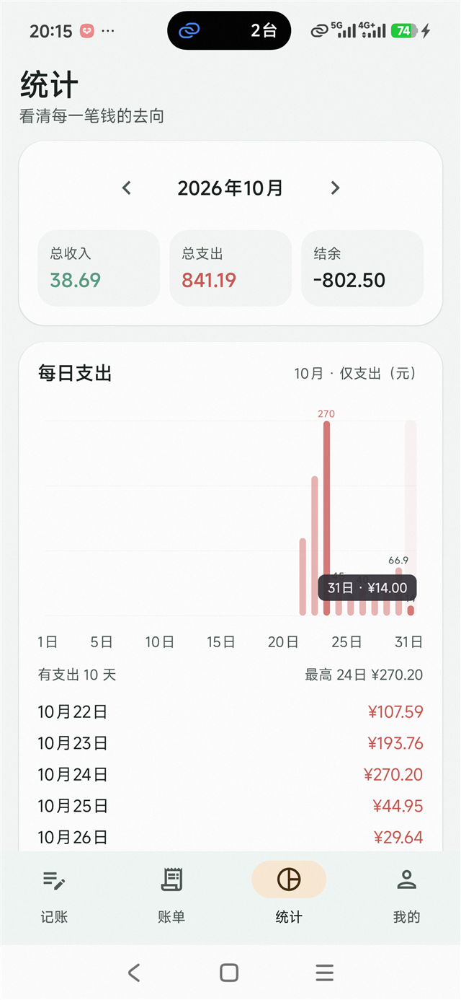

# 简记（JianJi）

<p align="center">
  
  
  
  
  
</p>

一款对标「喵喵记账」的本地优先个人记账 App。使用 **Kotlin + Jetpack Compose + Material 3 + Room + DataStore** 开发，最低支持 **Android 10（API 29）**，适配到 **Android 14（API 34）**。

支付短信 / 支付成功页**自动记账**、预算、图表统计全部离线完成——数据不出手机。

## 📱 截图

<table>
  <tr>
    <td width="50%"></td>
    <td width="50%"></td>
  </tr>
  <tr>
    <td align="center">首页 · 预算进度 / 消费构成 / 快速记账</td>
    <td align="center">统计 · 每日柱状图（点击柱子气泡显示当日金额）</td>
  </tr>
</table>

## ✨ v1.2 新特性

- **四层防重复入账**：交易单号稳定去重键、历史订单时间闸、账单列表页识别、入库前 24 小时同金额查重——点开已支付订单不再重复记账，短信+截图双渠道互斥
- **点柱子看明细**：统计页点任意一天，气泡显示精确金额，弹窗列出当日逐笔账单（商家/分类/来源/金额）
- **商家消费排行**：本月支出 TOP10，前三名金银铜牌 + 比例条，识屏/短信/手动账单自动归类商家
- 识别器单元测试 46 条全绿（含真实微信/支付宝页面布局回归）

> 所有账单默认只保存在手机本地 Room 数据库；CSV 导出通过系统文件选择器完成，不上传任何数据。
>
> **构建状态**：已使用 JDK 17 + Gradle 8.7 + AGP 8.5.2 + compileSdk 34 实际编译、R8 压缩并签名通过。
> 可直接安装的体验包：`dist/JianJi-v1.1.1.apk`（R8 压缩后约 47 MB，含离线中文 OCR 模型，已通过 `apksigner verify`）。
> 该包使用演示签名，正式上架请按第七节替换为你自己的 keystore。
>
> v1.1.1 新增 **屏幕识别自动记账（无障碍 + 本地 OCR）**：优先读支付页文字，微信/支付宝屏蔽文本时自动截图走 ML Kit 中文 OCR，识别金额、商户并生成账单（不联网、不保存截图）。

---

## 一、整体架构

采用「单 Activity + Compose + MVVM + Repository」的经典分层，避免引入 Hilt 等额外框架，降低构建与崩溃风险。

```
┌─────────────────────────────────────────────────────┐
│ UI 层（Jetpack Compose + Material 3）                │
│  HomeScreen / BillsScreen / StatsScreen              │
│  BudgetScreen / ProfileScreen / EditBillDialog       │
└───────────────────────┬─────────────────────────────┘
                        │ StateFlow / 事件
┌───────────────────────▼─────────────────────────────┐
│ ViewModel 层                                        │
│  BillViewModel / StatsViewModel / SettingsViewModel  │
└───────────────────────┬─────────────────────────────┘
                        │ suspend / Flow
┌───────────────────────▼─────────────────────────────┐
│ 数据层                                               │
│  BillRepository          SettingsRepository          │
│  Room (BillDao)          DataStore (budget/theme)    │
└───────────────────────▲─────────────────────────────┘
                        │ 写入
┌───────────────────────┴─────────────────────────────┐
│ 自动记账：SmsReceiver → SmsParser → Repository       │
│（goAsync + 协程 + 全量 try/catch，解析失败静默丢弃） │
└─────────────────────────────────────────────────────┘
```

设计要点：

1. **金额全部用 `Long` 存「分」**，杜绝 `Float/Double` 的精度问题。
2. **短信去重**：`BillEntity.smsHash` 建唯一索引，同一条短信重复投递时数据库直接忽略。
3. **UI 单一数据源**：所有页面都订阅 Room 的 `Flow`，手动记账、短信记账、修改、删除都会自动刷新。
4. **异常隔离**：短信解析、CSV 写入、DataStore 读取均使用 `runCatching` / `try-catch`，失败只提示，不崩溃。
5. **无第三方图表库**：饼图、折线图用 Compose `Canvas` 手绘，减少依赖冲突。

---

## 二、模块拆分

| 目录 | 职责 | 关键文件 |
|---|---|---|
| `data/` | Room 实体、DAO、数据库、仓库、DataStore 设置 | `BillEntity.kt`、`BillDao.kt`、`AppDatabase.kt`、`BillRepository.kt`、`SettingsRepository.kt` |
| `data/model/` | 收支类型、内置分类（餐饮/交通/购物/工资…） | `BillType.kt`、`Category.kt` |
| `sms/` | 短信广播接收、金额/收支/分类解析、去重 | `SmsReceiver.kt`、`SmsParser.kt` |
| `screen/` | 无障碍屏幕文本采集、支付成功页解析、自动记账、演示页 | `ScreenRecognitionService.kt`、`ScreenPaymentParser.kt`、`ScreenDemoActivity.kt` |
| `viewmodel/` | 页面状态、筛选、统计聚合、增删改 | `BillViewModel.kt`、`StatsViewModel.kt`、`SettingsViewModel.kt` |
| `ui/` | 根导航、主题 | `JianJiRoot.kt`、`theme/*` |
| `ui/screens/` | 5 个页面 | `HomeScreen.kt`、`BillsScreen.kt`、`StatsScreen.kt`、`BudgetScreen.kt`、`ProfileScreen.kt` |
| `ui/components/` | 复用组件：卡片、月份选择、分类宫格、图表、编辑弹窗、权限 | `Common.kt`、`Charts.kt`、`EditBillDialog.kt`、`SmsPermission.kt` |
| `util/` | 日期、金额、CSV | `DateUtils.kt`、`MoneyUtils.kt`、`CsvExporter.kt` |

### 功能与页面映射

| 需求 | 实现位置 |
|---|---|
| 快速记收入/支出、分类、金额、备注、日期 | `HomeScreen` + `CategoryGrid` + `JianJiDatePickerDialog` |
| 短信自动记账 | `SmsReceiver` + `SmsParser`，`ProfileScreen` 提供开关与授权入口 |
| 屏幕识别自动记账 | `ScreenRecognitionService`（无障碍）+ `ScreenPaymentParser`，识别支付成功页并生成账单 |
| 账单列表、按月/收支筛选、删除、修改 | `BillsScreen`（列表）+ `EditBillDialog`（修改） |
| 月度收支、分类饼图、6 个月趋势折线 | `StatsScreen` + `Charts.kt` |
| 月度预算、进度条、超支提醒 | `BudgetScreen`，首页 `BudgetCard` 同步显示 |
| 主题切换、CSV 导出、基础设置 | `ProfileScreen` + `SettingsRepository` |

---

## 三、依赖配置

根目录 `build.gradle.kts`：

```kotlin
plugins {
    id("com.android.application") version "8.5.2" apply false
    id("org.jetbrains.kotlin.android") version "2.0.20" apply false
    id("org.jetbrains.kotlin.plugin.compose") version "2.0.20" apply false
    id("com.google.devtools.ksp") version "2.0.20-1.0.25" apply false
}
```

`app/build.gradle.kts` 核心依赖：

```kotlin
implementation(platform("androidx.compose:compose-bom:2024.09.03"))
implementation("androidx.compose.material3:material3")
implementation("androidx.compose.material:material-icons-extended")
implementation("androidx.activity:activity-compose:1.9.2")
implementation("androidx.navigation:navigation-compose:2.8.0")
implementation("androidx.lifecycle:lifecycle-runtime-compose:2.8.6")
implementation("androidx.lifecycle:lifecycle-viewmodel-compose:2.8.6")

implementation("androidx.room:room-runtime:2.6.1")
implementation("androidx.room:room-ktx:2.6.1")
ksp("androidx.room:room-compiler:2.6.1")

implementation("androidx.datastore:datastore-preferences:1.1.1")
```

编译参数：

- `compileSdk = 34`、`targetSdk = 34`、`minSdk = 29`
- Java / Kotlin 目标版本 17
- Compose Compiler 由 Kotlin 2.0 的 `org.jetbrains.kotlin.plugin.compose` 提供，无需再写 `composeOptions`

---

## 四、权限处理

### 1. 短信权限（RECEIVE_SMS）

`AndroidManifest.xml`：

```xml
<uses-permission android:name="android.permission.RECEIVE_SMS" />

<receiver
    android:name=".sms.SmsReceiver"
    android:exported="true"
    android:permission="android.permission.BROADCAST_SMS">
    <intent-filter android:priority="999">
        <action android:name="android.provider.Telephony.SMS_RECEIVED" />
    </intent-filter>
</receiver>
```

运行时流程（`SmsPermission.kt`）：

1. 用户点击「开启自动记账」→ 先弹应用内说明（告诉用户读什么、为什么读、数据不出本机）；
2. 点「去授权」才触发系统权限框；
3. 被拒绝后，页面会显示红色「未授权」状态，并提供「系统设置」按钮跳转 `ACTION_APPLICATION_DETAILS_SETTINGS`；
4. 从系统设置返回时通过 `Lifecycle.Event.ON_RESUME` 自动刷新授权状态。

### 2. 存储权限

**不需要** `READ/WRITE_EXTERNAL_STORAGE`。CSV 导出使用 Storage Access Framework：

```kotlin
ActivityResultContracts.CreateDocument("text/csv")
```

用户自行选择保存位置（下载、网盘等），应用只拿到该 Uri 的写权限。这是 Android 10+ 分区存储下最稳、最合规的方案。

### 3. 屏幕识别与通知权限

- **无障碍服务**：`ScreenRecognitionService` 在 Manifest 中声明 `BIND_ACCESSIBILITY_SERVICE`，由用户在系统「无障碍」设置中手动开启；应用无法自行静默开启。
- **通知权限**：Android 13+ 发送「已自动记账」通知需要 `POST_NOTIFICATIONS`，在用户点击「去开启」时请求；即使用户拒绝，记账本身仍然生效，只是没有通知提醒。
- **不需要屏幕录制权限**：不申请 `MediaProjection`；优先读取文本节点，读不到时使用 Android 11+ 的无障碍截图 API（`canTakeScreenshot`）截取当前屏幕，在内存中交给 ML Kit OCR，识别完立即回收，不保存、不上传。

### 4. 合规提醒

`RECEIVE_SMS` 属于 Google Play 的「受限权限」，上架 Google Play 需要声明为核心功能并通过审核；国内应用商店通常允许工具类应用申请。若无法通过审核，可保留手动记账，将自动记账改为「粘贴短信识别」或「通知监听」方案。

---

## 五、短信自动记账规则

`SmsParser` 只处理同时满足以下条件的短信：

1. 含有明确收支动作：消费/支付/扣款/转出/收入/入账/转入/退款/到账等；
2. 含有金额，且带「元 / 人民币 / ¥」等货币标识；
3. 不含验证码、登录、积分兑换、账单查询等排除词。

金额提取顺序（从可靠到宽松）：

1. `消费人民币25.00元`（关键词 + 金额 + 元）
2. `人民币25.00元`（货币符号 + 金额 + 元）
3. `25.00元的支出`（金额 + 元 + 动作）
4. 关键词后跟金额（兜底）

分类推断示例：

| 短信关键词 | 分类 |
|---|---|
| 美团、饿了么、餐厅、咖啡 | 餐饮 |
| 滴滴、地铁、加油、高铁 | 交通 |
| 淘宝、京东、超市、商场 | 购物 |
| 工资、薪资、代发 | 工资 |
| 退款、退货 | 退款 |
| 利息、理财、分红 | 理财 |

失败处理：

- 解析异常 → `catch (Throwable)` 返回 `null`，广播接收器继续处理下一条；
- 金额为 0 / 超限 / 非法 → 丢弃；
- 重复短信 → `smsHash` 唯一索引冲突，`insert` 返回 `-1`，不重复记账；
- 未授权 / 关闭开关 → 接收器直接返回，不做任何事。

调试建议：用另一台手机或模拟器短信测试，发送内容如：

```
【招商银行】您尾号1234的储蓄卡10月20日12:30消费人民币25.50元，余额1000.00元。
```

应生成：支出 / 餐饮（或购物，取决于商户词）/ ¥25.50，备注含发送方与短信摘要。

---

## 六、屏幕识别自动记账（v1.1.1）

实现方式是 **无障碍文本优先 + 本地 OCR 兜底**：微信/支付宝有些支付页会把文字做成图片或屏蔽无障碍节点，此时用 Android 11+ 的无障碍截图 API 截一张图，交给 **ML Kit 中文 OCR** 在本地识别。不申请 MediaProjection、不联网上传、不保存截图，也不会代替用户点击或输入。

```
支付成功页
   ↓ ① AccessibilityService 读取所有窗口的文本节点
文本行列表
   ↓ 解析失败（微信/支付宝常见）
   ↓ ② AccessibilityService.takeScreenshot()（Android 11+）
   ↓ ③ ML Kit 中文 OCR（模型随 APK 打包，离线）
   ↓ ScreenPaymentParser
金额 + 收支方向 + 收款方 + 分类
   ↓ Room（source = SCREEN）
账单 + 通知「简记自动记了一笔支出」
```

### 开启步骤

1. 打开「我的」→「屏幕识别自动记账」→「去开启」；
2. 系统跳转到「无障碍」设置，找到 **简记屏幕识别**；
3. 阅读系统说明并开启；
4. 回到 App，状态变为「已开启」。

### 验证方式

「我的」→「测试识别」会打开一个 **Canvas 绘制的模拟支付成功页**（支付成功 / ¥1390.00 / 品宴江南）。这个页面的文字不是无障碍节点，正好复现微信/支付宝屏蔽文本的情况，只能走截图 OCR。服务开启后会自动生成：

- 支出 ¥1,390.00
- 分类：餐饮
- 来源：屏幕
- 备注：屏幕识别 · 品宴江南

账单页可以直接修改或删除这条记录。

### 解析规则

- 必须同时命中「支付成功 / 付款成功 / 交易成功 / 转账成功 / 已支付」等成功词和金额；
- 「支付失败 / 待支付 / 已取消 / 余额不足」直接忽略；
- 金额优先取页面顶部带 `¥/￥` 的实付金额，跳过「余额、优惠、红包、积分、手续费、立减、原价」；
- 收款方支持三种布局：
  - 「收款方 / 商户全称」标签同行或下一行；
  - 企业名（如「中国人民财产保险股份有限公司」）；
  - 微信常见「商户名在金额正上方」，如「品宴江南」在「¥1390.00」上方；
- 同一包名 + 金额在 **3 分钟**内只记一次，数据库 `smsHash` 唯一索引再兜底一次；
- 首次 OCR 需要加载模型（约几秒），之后会常驻内存。

### 限制与合规

1. Android 10 没有无障碍截图 API，只能用无障碍文本；Android 11+ 才会在文本读不到时启用截图 OCR；
2. 个别支付/银行页会设置 `FLAG_SECURE`，系统禁止截图，OCR 也无法读取，只能手动记账；
3. 不同银行/支付 App 文案差异大，建议用真实订单页补充规则；
4. 无障碍权限属于敏感权限，上架应用商店时需要明确说明「仅用于识别支付结果并本地记账」；
5. 自动记账是「先记后改」：识别错误时可在账单页修改或删除，不会影响原始数据。

---

## 七、打包 APK

### 方式 A：Android Studio（推荐）

1. 安装 **Android Studio Ladybug / Koala**（自带 JDK 17），SDK Manager 安装：
   - Android SDK Platform 34
   - Android SDK Build-Tools 34.0.0
   - Android SDK Platform-Tools
2. `File → Open` 选择项目根目录 `jianji/`（不是 `app/`）。
3. 项目已内置 Gradle Wrapper（`gradlew`、`gradlew.bat`、`gradle/wrapper/gradle-wrapper.jar`），Android Studio 会直接使用 `gradle-wrapper.properties` 中的 Gradle 8.7，无需手动生成。若公司网络无法访问 `services.gradle.org`，可在 `Settings → Build Tools → Gradle → Use Gradle from` 选择本机已安装的 Gradle 8.7。
4. 连接手机 / 启动模拟器，点击 Run ▶ 即可安装。
5. 生成正式包：`Build → Generate Signed Bundle / APK → APK`：
   - 新建 keystore（保存好，后续更新必须用同一个）
   - 选择 `release`
   - 勾选 `V1`、`V2` 签名
   - 输出：`app/release/app-release.apk`

### 方式 B：命令行

```bash
# 调试包（项目内自带 debug.keystore，无需配置）
./gradlew assembleDebug
# 输出：app/build/outputs/apk/debug/app-debug.apk

# 未签名的正式包（已开启 R8 + 资源压缩）
./gradlew assembleRelease
# 输出：app/build/outputs/apk/release/app-release-unsigned.apk

# 本地签名
$ANDROID_HOME/build-tools/34.0.0/zipalign -p -f 4 \
  app/build/outputs/apk/release/app-release-unsigned.apk app-release-aligned.apk
$ANDROID_HOME/build-tools/34.0.0/apksigner sign \
  --ks jianji-release.jks --ks-key-alias jianji \
  --out app-release.apk app-release-aligned.apk
```

也可以在 `app/build.gradle.kts` 中读取 `keystore.properties` 配置 `signingConfigs.release`，让 `assembleRelease` 直接产出签名包：

```kotlin
import java.util.Properties

val keystoreProps = Properties().apply {
    val f = rootProject.file("keystore.properties")
    if (f.exists()) f.inputStream().use { load(it) }
}

android {
    signingConfigs {
        create("release") {
            storeFile = file(keystoreProps.getProperty("storeFile") ?: "release.jks")
            storePassword = keystoreProps.getProperty("storePassword")
            keyAlias = keystoreProps.getProperty("keyAlias")
            keyPassword = keystoreProps.getProperty("keyPassword")
        }
    }
    buildTypes {
        release {
            signingConfig = signingConfigs.getByName("release")
        }
    }
}
```

`keystore.properties` 示例（务必加入 `.gitignore`）：

```properties
storeFile=../jianji-release.jks
storePassword=******
keyAlias=jianji
keyPassword=******
```

### 已提供的体验包

| 项目 | 值 |
|---|---|
| 文件 | `dist/JianJi-v1.1.1.apk` |
| 大小 | 47,392,994 字节（约 47 MB，含离线中文 OCR 模型） |
| 包名 | `com.jianji.app` |
| 版本 | 1.1.1（versionCode 3） |
| minSdk / targetSdk | 29 / 34 |
| SHA-256 | `9FCE4D88F4AF1C0706BB83BC98E04C820111FFA1DF19379D9F9F9AB4EECF68D2` |
| 签名证书 SHA-256 | `C725D994DAE775E206D9C128EB8A18484B2A31B81CF78374896ECCB233B3AB46` |

> 该 APK 使用项目内 `debug.keystore` 演示签名，仅用于体验与验收。正式发布请务必生成自己的 keystore 重新签名。v1.1.1 与 v1.1.0 使用同一演示签名，可直接覆盖安装；但 v1.0.0 使用的是另一把演示签名，若设备上装过 v1.0.0，需要先卸载旧版。

安装：

```bash
adb install -r dist/JianJi-v1.1.1.apk
```

### 安装

```bash
adb install -r app/build/outputs/apk/debug/app-debug.apk
```

首次打开后：

1. 进入「我的」→ 打开「短信自动记账」→ 授权短信权限；
2. 回到「记账」页手动记一笔，确认首页预算卡、账单列表、统计页同步更新；
3. 用测试短信验证自动记账；
4. 在「我的」中导出 CSV，用 Excel 打开检查中文是否正常。

---

## 八、测试清单

### 自动化测试

```bash
./gradlew testDebugUnitTest
```

`app/src/test/java/com/jianji/app/sms/SmsParserTest.kt` 与 `app/src/test/java/com/jianji/app/screen/ScreenPaymentParserTest.kt` 共覆盖 **20 个场景**：

- 短信 11 项：银行消费、工资入账、退款、金额前置句式、支付宝到账、含「登录」提示的银行短信、「交易」中性词、验证码、营销短信、无金额通知、去重哈希稳定性；
- 屏幕 9 项：支付宝支付成功、微信商户名、微信真实布局（金额上方商户名）、支付宝真实布局（实付/原价/立减）、退款入账、支付失败、余额页、成功页无金额、3 分钟去重窗口。

这些测试均为纯 JVM 测试，无需连接手机。

### 手工验收清单

- [ ] 手动记支出 / 收入，金额 0、负数、超长、多个小数点均被拦截
- [ ] 修改账单后列表、统计、预算同步更新
- [ ] 删除账单有二次确认
- [ ] 切换月份、收支筛选正确
- [ ] 饼图分类占比之和为 100%
- [ ] 近 6 个月折线图无数据时显示坐标网格但不崩溃
- [ ] 设置预算后首页进度条颜色变化，超支显示红色文案
- [ ] 深色 / 浅色 / 跟随系统切换后重启仍保持
- [ ] 拒绝短信权限后应用不崩溃，可跳转系统设置
- [ ] 飞行模式下记一笔、导出 CSV 正常
- [ ] 连续发送同一条短信两次，只生成一条账单

---

## 九、已知限制与后续可扩展

1. **短信识别是启发式规则**，不同银行模板差异大，建议上线前收集真实短信样本补充正则；
2. 部分双卡设备会把同一条短信投递两次，已通过哈希唯一索引兜底；
3. 不读取历史收件箱（避免 `READ_SMS` 更高权限与合规风险），只监听新短信；
4. 未实现云同步 / 多设备，数据仅本机；
5. 预算按自然月统计，暂不支持自定义周期；
6. 图表为手绘实现，若需要点击查看某分类明细，可在 `DonutChart` 上增加 `pointerInput` 命中检测；
7. 屏幕识别优先无障碍文本，Android 11+ 才有截图 OCR 兜底；FLAG_SECURE 页面无法截图；
8. 支付页文案千差万别，自动记账属于「先记后改」，识别错误时请在账单页修改或删除；
9. 无障碍权限在 Google Play 审核非常严格，上架前需要准备用途说明与演示视频。

---

## 十、项目结构

```
jianji/
├── settings.gradle.kts
├── build.gradle.kts
├── gradle.properties
├── gradle/wrapper/gradle-wrapper.properties
├── app/
│   ├── build.gradle.kts
│   ├── proguard-rules.pro
│   └── src/main/
│       ├── AndroidManifest.xml
│       ├── java/com/jianji/app/
│       │   ├── JianJiApp.kt
│       │   ├── MainActivity.kt
│       │   ├── data/
│       │   ├── sms/
│       │   ├── screen/
│       │   ├── util/
│       │   ├── viewmodel/
│       │   └── ui/
│       └── res/
│           ├── drawable/ic_launcher_foreground.xml
│           ├── mipmap-anydpi-v26/
│           └── values{,-night}/
└── README.md
```

---

**License / 声明**：本项目为个人记账工具示例，短信解析仅用于用户本机记账，请勿用于收集他人信息。

